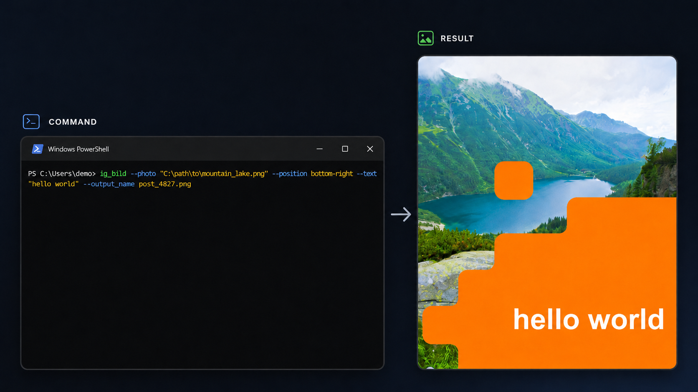
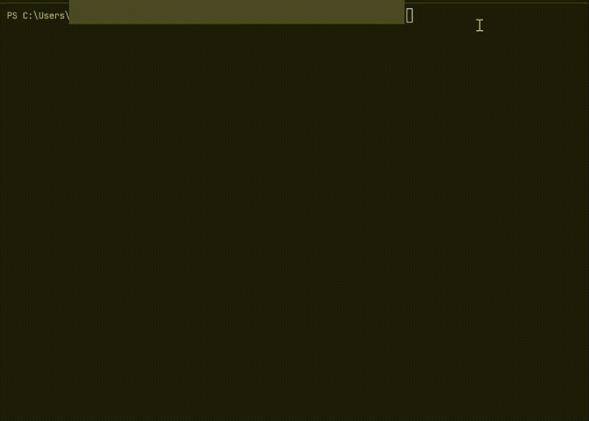

# 📸 IG-Bild-Gen — Automatic Instagram Post Generator

## 📌 Overview

**ig-bild** is a Python command-line tool for generating Instagram-ready images in portrait format **1080×1350 px**.

The program takes an input photo, crops it to the Instagram 4:5 format, adds an orange overlay shape, places custom text inside the overlay, and exports the final image as a PNG file.

The tool can be used in two ways:

1. **Full command mode** — run the generator with one complete command.
2. **Interactive mode** — answer the required options step by step.

---

## 🎬 Demo

### Full Command Mode



### Interactive Mode



---

## ✨ Features

- Generates Instagram portrait images in **4:5 format**
- Automatically crops the input image to the correct size
- Adds an orange overlay shape
- Supports different overlay positions
- Allows custom text inside the overlay
- Supports X and Y text offset adjustment
- Supports custom text color and optional stroke color
- Supports custom `.ttf` fonts
- Supports preview mode before saving
- Can be used normally or with Docker

---

## 🛠️ Tech Stack

- **Python 3**
- **Pillow**
- **argparse**
- **Docker**

---

## 🚀 Installation

Clone the repository:

```bash
git clone <repo-url>
cd automatische-instagram-bildgenerierung-2
```

Install dependencies:

```bash
pip install -r requirements.txt
```

Or install the project as a local package:

```bash
pip install -e .
```

After installing the package, you can use:

```bash
ig_bild --help
```

---

## ▶️ Usage

### Full Command Mode

Use this mode when you want to generate an image directly with one command.

Using `main.py`:

```bash
python main.py --photo BG.jpg --position bottom-right  --text "THWS Partner University"  --output_name post.png
```

Using the installed command:

```bash
ig_bild --photo BG.jpg --position bottom-right  --text "THWS Partner University" --output_name post.png
```

Example with preview mode:

```bash
ig_bild --photo BG.jpg --position random  --text "Campus Life"  --output_name preview_post.png --preview
```

---

### Interactive Mode

Use this mode when you do not want to write all options manually.

```bash
python main.py
```

Or, if the package is installed:

```bash
ig_bild
```

Example interaction:

```text
Interactive Instagram Post Generator
------------------------------------
Image path: BG.jpg
Text: THWS Partner University
Available positions:
- bottom-left
- bottom-right
- top-left
- top-right
- left
- right
- random
Position [bottom-right]: bottom-right
X offset [0]: 0
Y offset [0]: 0
Output folder [.]: .
Output filename [post_20260614_120000.png]: post.png
Open preview? [no]: no
Custom font path []:
Text color [white]: white
Stroke color []:
```

After the questions are answered, the image is generated and saved.

---

## 👁️ Preview Mode

Preview mode can be started with the `--preview` flag.

```bash
ig_bild --photo BG.jpg --position random  --text "Campus Life"  --output_name preview_post.png --preview
```

In preview mode, the program shows the generated image and provides these options:

```text
[R] regenerate   [S] save & quit   [Z] zurück (pick previous)   [Q] quit without saving
```

| Key | Action |
| --- | ------ |
| `R` | Regenerate the image |
| `S` | Save the current image and quit |
| `Z` | Go back and save a previous variation |
| `Q` | Quit without saving |

---

## 🐳 Docker Usage

You can also run the project with Docker.

First, Open Docker Desktop..

Wait until it says Docker Desktop is running

Then build the Docker image with :

```bash
docker build -t ig-bild .
```

After that, use the helper script:

```bash
./run-docker.sh  --photo BG.jpg --position bottom-right --text "THWS Partner University" --output_name docker_post.png
```
Use `run-docker.sh` on macOS/Linux/Git Bash and `run-docker.ps1` on Windows PowerShell.
For interactive mode, run:

```bash
./run-docker.sh
```

> Note: Preview windows may not work inside a normal Docker container. When using Docker, it is recommended to run the program without preview mode.

---

## ⚙️ Docker Helper Script

The repository includes a helper script called `run-docker.sh`:

```bash
#!/usr/bin/env bash

docker run --rm -it \
  -v "$(pwd):/work" \
  -w /work \
  ig-bild \
  ig_bild "$@"
```

Make sure it is executable:

```bash
chmod +x run-docker.sh
```

---

## 📦 Output

The generated file is saved as a PNG image.

Examples:

```text
post_20260614_120000.png
post.png
docker_post.png
```

---

## 🧩 Parameters

| Parameter | Description | Default | Required |
| --- | --- | --- | --- |
| `--photo` | Path to the input image | None | Yes |
| `--position` | Overlay position: `bottom-left`, `bottom-right`, `top-left`, `top-right`, `left`, `right`, `random` | None | Yes |
| `--text` | Text displayed inside the overlay | None | Yes |
| `--x` | Horizontal text offset in pixels | `0` | No |
| `--y` | Vertical text offset in pixels | `0` | No |
| `--output_path` | Folder where the generated image is saved | `.` | No |
| `--output_name` | Output file name | `post_YYYYMMDD_HHMMSS.png` | No |
| `--preview` | Opens preview mode before saving | Disabled | No |
| `--font` | Path to a custom `.ttf` font file | None | No |
| `--text_color` | Text color, for example `white`, `red`, or `#FFFFFF` | `white` | No |
| `--stroke_color` | Optional text outline color, for example `black` | None | No |

---

## ❗ Common Problems

### Image not found

Make sure the path in `--photo` is correct.

```bash
ig_bild --photo BG.jpg --position bottom-right --text "Hello"
```

### Font file not found

If you use `--font`, make sure the `.ttf` file path exists.

### Docker preview does not open

GUI preview windows may not work inside a normal Docker container. Use Docker without preview mode.

---

## 📁 Project Structure

```text
.
├── Dockerfile
├── main.py
├── pyproject.toml
├── requirements.txt
├── README.md
├── run-docker.sh
├── docs/
│   ├── images/
│   │   └── full-command-mode.png
│   └── gifs/
│       └── interactive-mode.gif
├── src/
│   └── post_generator/
│       ├── app.py
│       ├── cli.py
│       ├── config.py
│       ├── runner.py
│       └── services/
│           ├── composition.py
│           ├── mask.py
│           ├── overlay_service.py
│           ├── post_generator.py
│           ├── preview.py
│           ├── textrenderer.py
│           └── transform.py
└── tests/
```

---

## 👥 Authors

- Mhd Zaher Shaiban
- Burak Ince
- Orik Mazreku
- Abdullah Aydin Lüleci
